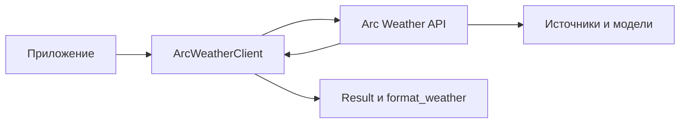

# Архитектура Arc Weather SDK

SDK — тонкий клиент Arc Weather API. Он не обращается к источникам данных и не содержит
моделей расчёта: всё, что требует источников, ключей и алгоритмов, выполняется на стороне
сервиса.

## Слои

| Модуль | Назначение |
| --- | --- |
| `models.py` | `Point`, `Forecast`, `SourceData`, `PlanetaryData`, `SourceUnavailable` |
| `queries.py` | `ForecastQuery`, `CityQuery`, `RegionalQuery`, `PlanetQuery` |
| `result.py` | Конверт `Result`, сериализация и разбор ответа |
| `regions.py` | Профили регионов `REGIONS` |
| `client.py` | HTTP-клиент, эндпоинты, разбор ошибок |
| `presentation.py` | `weather_payload` и `format_weather` |
| `errors.py` | `ArcWeatherError` и наследники |

## Контракт ответа

Сервис и SDK разделены конвертом `Result`. Каждая операция возвращает модуль, имя операции,
статус и список элементов. Элемент несёт поле `type`, по которому SDK восстанавливает модель.
Статусы `ok`, `empty`, `partial` и `unavailable` различают пустую выборку, частичный ответ
и недоступность источников — клиенту не нужно разбирать текст ошибки, чтобы отличить
«данных нет» от «данные не пришли».

## Соединение

`ArcWeatherClient` не создаёт и не закрывает соединение. Приложение передаёт свой
`httpx.AsyncClient`, поэтому все вызовы делят пул и таймауты хост-приложения. Клиент
хранит базовый адрес, ключ и User-Agent, добавляет `X-API-Key` к каждому запросу и приводит
ответы HTTP к исключениям `ArcWeatherError`.

## Ошибки

Коды ответа отображаются в типы ошибок: `401` и `403` — `AuthenticationError`, `429` —
`RateLimitError` с полем `retry_after`, `404` — `NotFoundError`, остальные — `ApiError`
со статусом и телом ответа. Сетевые сбои также превращаются в `ApiError`, поэтому
приложению не нужно обрабатывать исключения `httpx` отдельно.

## Расширение

SDK намеренно не содержит реестра модулей и механизма пользовательских операций: набор
операций задаёт сервис, а каталог доступен через `client.modules()`. Новые источники и
модели добавляются на стороне сервиса и появляются в каталоге без изменений в SDK.
